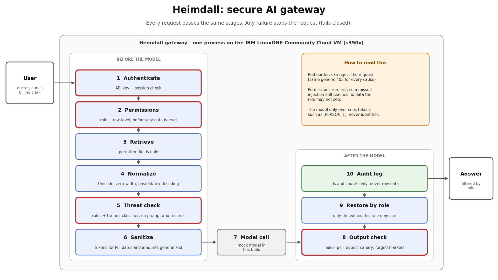
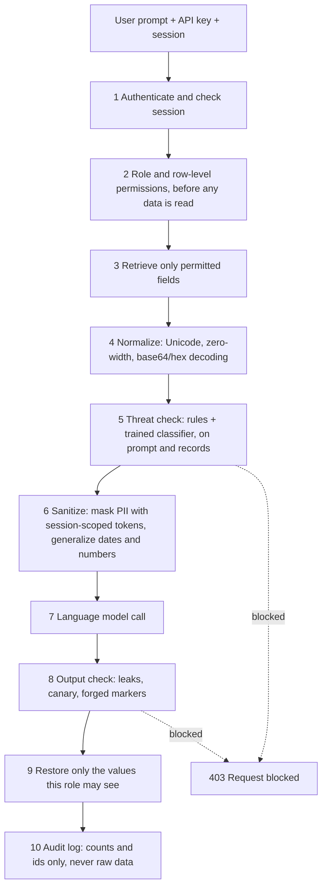

# Heimdall: a secure AI gateway

**Aegis_IBM Z Datathon 2026 Project** | Event code: SSF2026 | Theme: AI Secured, Innovation Without Exposure

Team Aegis: Hareesh V, Muhammed Shifas NK, Devi Vrinda A, Rithun K P, Shyaam Menon.
Output control and audit logging were contributed by Muhammed Shifas NK (PR #1).

## Differences from our original abstract

The PDF groups the design into 5 stages. The README flow shows 10 steps, which split those same 5 stages into smaller steps for clarity.

- The PDF's “air-gapped,” “hardware-enforced isolation,” and “secure enclaves” descriptions do not match this implementation: the gateway runs as an ordinary process on the VM, and the LLM is a deterministic mock.
- The PDF's k-anonymity claim is not supported: Stage 4 generalization is implemented, but measured k on the 12-record seeded dataset is 1.
- The PDF's SIEM alert claim is not implemented; Heimdall writes only a local audit log.

## The problem

Hospitals, banks and colleges want AI assistants over their records, but putting a language model in front of sensitive data creates three risks: users paste personal data into prompts, assistants ignore who is allowed to see what, and attackers use prompt injection to extract data or instructions.

- The U.S. Department of Health and Human Services received 663 reports of 2024 breaches affecting 500 or more people; these affected approximately 242,908,056 individuals ([HHS 2024 breach report](https://www.hhs.gov/sites/default/files/breach-report-to-congress-2024.pdf)).
- Healthcare breach costs averaged $9.77 million in IBM's 2024 Cost of a Data Breach study ([IBM report summary](https://newsroom.ibm.com/2024-07-30-ibm-report-escalating-data-breach-disruption-pushes-costs-to-new-highs)).
- In a Q1 2024 McKinsey survey of 100 US healthcare leaders, more than 70% said their organizations were pursuing or had implemented generative AI ([McKinsey survey summary](https://www.mckinsey.com/industries/healthcare/our-insights/generative-ai-in-healthcare-adoption-trends-and-whats-next)).

## What Heimdall does



Heimdall is a gateway that sits between a user and the model. Every request passes the same stages, and any failure stops the request (it fails closed).



Key design points:
- **Permissions come first.** A nurse's request never retrieves billing data, so the model cannot leak it. A persona attack that slips past the classifier therefore still gets nothing.
- **The model sees tokens, not identities.** Names, phones and IDs become markers such as `[PERSON_1]`; dates, vitals and amounts are generalized into bands.
- **Tokens are encrypted per session** (AES-GCM) and wiped when the session is deleted or expires.
- **Errors are generic.** Unknown users, unassigned patients and other people's sessions all get the same 403.

## How it uses IBM LinuxONE

Verified on the LinuxONE Community Cloud VM (evidence in `evidence/platform-*.txt`):
- Architecture `s390x`, big endian, z/VM 7.3 hypervisor, 3 CPUs, 7.8 GiB RAM.
- 88 unit tests pass on the VM (s390x), and the held-out final run was executed there.
- **The threat classifier was trained on the VM** (TF-IDF + logistic regression with scikit-learn 1.4.1.post1 from the Ubuntu packages). The model is saved as portable JSON and inference is pure Python, so the same artifact loads on the big-endian VM and on an x86 laptop (a test checks it against scikit-learn).
- The evaluation, 1,097 pipeline requests, ran on the VM; latency per stage is in `eval/results/latest-vm.md`.
- The CPU flags report the hardware crypto (`msa`) and on-chip AI (`nnpa`) facilities. Heimdall does not use `nnpa`, and we do not claim hardware acceleration.
- Heavier models (PyTorch, ONNX Runtime) have no package for this VM, which is why the classifier is small. No container runtime was available on the VM, so we make no containerization claim.

## Results

All numbers are measured by `eval/run_eval.py`; counts in brackets. Probes are synthetic and generated by our own tooling, the language model is a deterministic mock, and the sets are small. See "Limitations".

| Measure | Heimdall | Regex-only baseline |
|---|---|---|
| PII detection, plain probes | recall 100.0% [150/150], false positives 0/150 | recall 98.0% [147/150], false positives 49/150 (32.7%) |
| PII detection, obfuscated probes | recall 83.3% [50/60] | recall 28.3% [17/60] |
| Unauthorized disclosure, per role | 0/60 (38 distinct queries) | n/a |
| Output leaks | 0/60 (51 distinct probes) | n/a |
| Cross-session attacks | 30/30 blocked, 0 successes | n/a |
| Data exposed after a missed injection | 0/201 role runs (mock model) | n/a |

Stage 4 generalization was measured with `eval/k_anonymity.py` on the 12-record seeded synthetic dataset: k=1 on raw values and k=1 after generalization (11 equivalence classes). We make no k-anonymity guarantee. See `eval/results/k-anonymity.md`.

Obfuscated probes, per kind (10 each, one pattern repeated): zero-width phone, zero-width email, base64 email, hex and mixed-case API key all 100%; **short base64 phones 0%** (15 encoded characters, below the 16-character decoding minimum).

Prompt-injection detection:

| Set | Rules only | Classifier only | Combined |
|---|---|---|---|
| Our injection probes (100 rows, 19 distinct) recall | 0.0% | 33.0% | 33.0% |
| External public test split (364 rows) recall | | | 89.3% (false positives 0%) |
| **Final held-out set (n=30: 15 attacks, 15 benign)** | recall 20.0% [3/15] | 66.7% [10/15] | **80.0% [12/15], false positives 0/15** |

The 89.3% external test result was also used to compare ablation options, so it is not an untouched post-selection measurement. The final set was written once by a separate AI chat assistant, committed since M3, never edited, and the coding assistant was told not to open it. It is small, and two attack styles are close to our development prompts.
The three misses were a persona impersonation (score 0.595), a fake [SYSTEM] maintenance message (0.567) and an instruction hidden in a billing note (0.341). The final report was regenerated once with `--force` after a table-rendering fix; the counts did not change.

On the s390x VM (n=1,097 requests, mock LLM), the threat stage was the slowest at p50 0.30 ms and p95 1.74 ms. Every other stage had reported p95 at or below 0.20 ms (the table is rounded to two decimals). These figures measure gateway overhead only, not a real model's response time.

Reports: `eval/results/latest.md` (laptop), `latest-vm.md` (LinuxONE), `final-latest.md` (final set).

## Run it

```
python -m venv .venv && source .venv/bin/activate     # Windows: .venv\Scripts\activate
pip install -r requirements-laptop.txt
python -m unittest discover -s tests -v                 # 88 tests
python scripts/demo_pipeline.py                          # three roles, an injection, a PII prompt
python eval/run_eval.py                                  # evaluation
python eval/k_anonymity.py                             # k-anonymity measurement
```
On the LinuxONE VM use `scripts/setup_vm.sh` and `make test`. Demo API keys and the vault key are generated at run time; nothing secret is stored in the repository.

## Limitations (what Heimdall does not do)

- The language model in this submission is a **deterministic mock**. `LocalLLM` and `ExternalLLM` are stubs, so we make no claim about real-model behavior.
- The classifier is trained on templated and public data and misses many attacks: persona impersonation, fake system messages and instructions hidden in free text are weak spots.
- Names written in free text are masked only when they match the patient record.
- Encoded values shorter than 16 characters are not decoded; PII split across sentences is not reassembled.
- Doctors can see `billing_amount` by policy.
- Sessions live in memory in a single process and are lost on restart.
- We did not test against adaptive attackers or measure real-world accuracy. Probes and system were written by the same team.
- Stage 4 generalization does not guarantee k-anonymity; measured k was 1 on raw values and k=1 after generalization (11 equivalence classes) on the seeded 12-record dataset. See `eval/results/k-anonymity.md`.

## Future work

A transformer-based classifier could be trained in the LinuxONE JupyterLab environment and evaluated on a new held-out set; this was not done here.

## Repository map

`gateway/` pipeline modules | `eval/` data generators, baselines, runner | `models/` classifier artifact and metrics | `tests/` unit tests | `scripts/` demo and setup | `docs/` interfaces, threat model, progress | `evidence/` platform evidence.

## Credits and licenses

Datasets: [Lakera/gandalf_ignore_instructions](https://huggingface.co/datasets/Lakera/gandalf_ignore_instructions) (MIT) and [jackhhao/jailbreak-classification](https://huggingface.co/datasets/jackhhao/jailbreak-classification) (Apache-2.0). We skipped deepset/prompt-injections because its card declares two licenses.
Libraries: [FastAPI](https://github.com/fastapi/fastapi), [Uvicorn](https://github.com/encode/uvicorn), [scikit-learn](https://github.com/scikit-learn/scikit-learn), [NumPy](https://github.com/numpy/numpy), [SciPy](https://github.com/scipy/scipy), [cryptography](https://github.com/pyca/cryptography), [Faker](https://github.com/joke2k/faker). See each project for its license; `THIRD_PARTY.md` lists everything used.

AI assistance: we used an AI coding assistant to write most of the code, and a separate AI chat assistant for planning, review and for writing the final held-out prompt set. We reviewed the code, tests and results ourselves.
